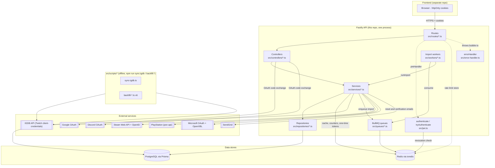

# Codebase Map

> Auto-generated by Cartographer. Last mapped: 2026-10-12T23:41:25Z

## System Overview

Fastify + Prisma + PostgreSQL + Redis backend for "Lib" (product name: EuZerei), a personal game-library tracker. Frontend is a separate React+Vite repo (`lib-front-end`), out of scope here. Layered: routes → controllers → services → repositories → Prisma/Postgres, with Redis as cache, rate-limit store, short-lived token store and BullMQ backend. IGDB is the game-data provider; Steam, PlayStation and Xbox libraries are imported by background jobs. No DI container: each route file wires its own controller/service/repository graph.



## Directory Structure

```
src/
  index.ts         loads dotenv, calls Server.start() (not awaited)
  server.ts        Fastify instance, plugins, rate limit, routes, starts the import workers
  jwt.ts           JWT + cookie + CORS plugins, authenticate / tryAuthenticate decorators
  error-handler.ts single global error handler
  routes/          per-resource route registration (manual wiring), 10 files, 72 routes
  controllers/     parse Zod -> call service -> shape reply (exceptions listed under Gotchas)
  services/        business rules, cache-aside, external API clients
  repositories/    sole Prisma/Redis access point per domain
  schemas/         Zod schemas (runtime validation + route typing)
  queues/          BullMQ connection, one queue per platform, shared enqueue/status helpers
  workers/         one BullMQ worker per platform, started inside the API process
  utils/           small pure helpers (cookies, hashing, completion heuristics, timeouts...)
  types/           raw shapes (IGDB, DTOs, sort params), fastify.d.ts augmentation
  dtos/            plain input DTOs at the repo/service boundary
  errors/          ClientError, IGDBRequestError
  database/        prisma + redis singletons
  scripts/         sync-igdb.ts + purge-erotic.ts + 7 backfill scripts (5 idempotent, plus `backfill-game-modes.ts` and `backfill-game-status.ts`, resumable full passes)
  test-utils/      fake platform service shared by the import tests
prisma/
  schema.prisma
  migrations/      33 migrations, see Schema evolution below
  dbml/schema.dbml generated by prisma-dbml-generator on every `prisma generate` (tracked, do not hand-edit)
  seed-test-users.ts  works: 4 test accounts with libraries, reviews and ratings
  seed-reviews.ts  works: 9 accounts x the 8 most recent released games of the largest library, one review scenario per status (`seed-reviews-N@teste.local`, `npm run seed:reviews`, `-- --clean`)
  seed-demo.ts     works: demo data, 80 accounts x the 60 most rated games, deterministic (`SEED_DEMO_SEED`), DiceBear avatars as `data:` URIs (the front CSP allows `data:`), ratings/reviews/stats/platforms/follows that respect the backend rules, self-validating (`demo-NN@teste.local`, `npm run seed:demo`, `-- --clean`); data in `seed-demo/data.ts`
docs/
  redis-caching.md historical design note, stale (see Gotchas)
  CODEBASE_MAP.md  this file
```

Tests live next to the code as `*.test.ts` (Vitest, 18 files). Services are tested with hand-written fakes of the repositories; there are no repository or HTTP-level tests.

## Prisma Schema

Generators: `prisma-client-js` + `prisma-dbml-generator`.

| Model | Table | Key fields | Relations | Notes |
|---|---|---|---|---|
| `User` | `users` | `email`(unique, lowercase), `emailVerifiedAt`(nullable), `termsAcceptedAt` and `termsVersion`(both nullable: set on e-mail sign-ups and on OAuth sign-ups that carried the acceptance, empty on accounts created before 2026-10-25; linking a provider never touches them), `userName`, `password`, `profilePicture`, `userBanner`, unique nullable `googleId`, `discordId`, `steamId`, `psnAccountId`, `xboxXuid`; plain `psnOnlineId`, `xboxGamertag` | hasMany `UserGame`, `RefreshToken`, `Rating`, `Review`, `Follow` (both directions), all cascade | `password` is NOT nullable: OAuth users get a random bcrypt hash they never use. `updatedAt` is `@default(now())`, not `@updatedAt`, so it never changes. |
| `RefreshToken` | `refresh_token` | `tokenHash`(unique, sha256), `expiresAt`, `isValid` | belongsTo `User`, cascade | One row per device session (max 10 per user, oldest dropped). `saveToken` only deletes the user's invalidated/expired rows; the refresh JWT carries a `jti` so same-second logins never collide. Columns are camelCase (no `@map`). |
| `UserGame` | `user_games` | `igdbId`(Int, no FK), `userGamesStatusId`, `completedAt`(nullable), `endless`(Boolean, default false), `endlessLocked`(Boolean, default false), unique `[userId, igdbId]` | belongsTo `User` (cascade) and `UserGamesStatus`; hasOne `UserGameStats`; hasMany `UserGamePlatform` | The library row. Game metadata is joined by raw SQL to `games_cache`, never a DB-level FK. |
| `UserGameStats` | `user_game_stats` | `completions`(default 0), `hoursPlayed`(Decimal(6,2), nullable), unique `userGameId` | belongsTo `UserGame`, cascade | Game-level totals. Once a game has platform rows these are recomputed from them and can no longer be edited directly. `completions` is history: changing status never lowers it (moving to PLAYED only raises 0 to 1 via `ensureAtLeastOneCompletion`); new rows start at 1 only when the game is added as PLAYED. Manual edits keep it at 1 or more on PLAYED and 0 or more otherwise. Migration `20261015230000_reset_false_completions` zeroed the old default-1 rows of non-played games without platforms. |
| `UserGamePlatform` | `user_game_platforms` | `platform`(enum), `console`(enum, default `UNKNOWN`), `hoursPlayed`, `completions`, `completedAt`, unique `[userGameId, platform, console]` | belongsTo `UserGame`, cascade | Per-console stats (one row per platform + console), written by the imports and by `/users/platforms`. `console` is never NULL because NULL in a unique index allows duplicates. |
| `Platform` (enum) | n/a | `STEAM, PLAYSTATION, XBOX, NINTENDO, EPIC, GOG, OTHER` | n/a | |
| `Console` (enum) | n/a | `UNKNOWN`, PlayStation (`PS1`..`PS5`, `PSP`, `PS_VITA`), Xbox (`XBOX_ORIGINAL`, `XBOX_360`, `XBOX_ONE`, `XBOX_SERIES`, plus `PC` for Game Pass on PC), Nintendo (`NES`..`SWITCH_2`, `GAME_BOY*`, `DS`, `N3DS`), `PC`, `STEAM_DECK`, Sega, Atari/retro, `MOBILE`, `ARCADE` | n/a | Own enum, not the IGDB platform id. Which console fits which `Platform` lives in `CONSOLES_BY_PLATFORM` (`src/utils/platform-consoles.ts`), used by the zod params schema and the service. `OTHER` takes any console; `UNKNOWN` fits every platform. |
| `CompletionSuggestion` | `completion_suggestions` | `userGameId`(unique, cascade), `platform`, `status`(enum `SuggestionStatus`: `PENDING`, `ACCEPTED`, `DISMISSED`), `evidence`(Json: hours, time to beat, achievements, signals), `lowConfidence`, `undoSnapshot`(Json?), `resolvedAt` | belongsTo `UserGame` | One "maybe finished" suggestion per game, written by the Steam import and resolved by the user. Never changes a status by itself. |
| `UserGamesStatus` | `users_games_status` | `id`(autoincrement), `status`(enum `Status`) | hasMany `UserGame` | Lookup table. The code hard-codes the ids: 1 PLAYED, 2 PAUSED, 3 PLAYING, 4 BACKLOG, 5 WISHLIST, 6 DROPPED. The rows must exist with those ids: the `seed_initial_status_rows` migration inserts 1 to 5 and `seed_dropped_status_row` inserts 6, both idempotent (`ON CONFLICT DO NOTHING`). There is no seed for them. |
| `Status` (enum) | n/a | `PLAYED, PAUSED, PLAYING, BACKLOG, WISHLIST, DROPPED` | n/a | `PAUSED` means "stopped, intends to come back"; `DROPPED` means "stopped for good". Only the user sets either one. `DROPPED` was added in its own migration because Postgres cannot use a new enum value in the transaction that creates it. |
| `Rating` | `ratings` | `value`(Float, 0-5), unique `[userId, igdbId]`, index `igdbId` | belongsTo `User`, cascade | One rating per user per game. |
| `Review` | `reviews` | `text`(1-2000 chars), unique `[userId, igdbId]`, index `igdbId` | belongsTo `User`, cascade | One review per user per game. |
| `Follow` | `follows` | `followerId`, `followingId`, unique pair, index `followingId` | both sides belongTo `User`, cascade | One-directional follow, no approval, no privacy flag. |
| `GameCache` | `games_cache` | `igdbId`(pk), `name`, `coverUrl`, `summary`, `genres[]`, `platforms[]`, `releaseDate`(epoch seconds, int4), `hypes`, `totalRatingCount`, `category`, `parentGameId`, `gameModes`(Int[], IGDB game mode ids), `gameStatus`(Int?, IGDB `game_status` id: 0 Released, 2 Alpha, 3 Beta, 4 Early Access, 5 Offline, 6 Cancelled, 7 Rumored, 8 Delisted; NULL = no status), `syncedAt` | none | NOT a TTL cache: a manually synced IGDB mirror used for listing, search, sort and joins. |

### Schema evolution

1. `20250502232217_init`: old relational catalog (`Game`/`Platform`/`Category`/`GameStudio`/`Publisher`).
2. 2025-05 to 2025-07 (12 migrations): `UserGame` changes, `UserGameStats`, `Rating`, Google OAuth, the `UserGamesStatus` lookup, `PAUSED` status.
3. `20251230123626_add_discord_id`: Discord OAuth.
4. `20260623113545_replace_games_with_igdb`: the pivot. Drops the whole local catalog; `UserGame`/`Rating` switch to raw `igdbId`. The old `prisma/seed.ts` broke here and was removed.
5. 2026-06 to 2026-08: `games_cache` created and enriched (`hypes`, `totalRatingCount`, `category`/`parentGameId`), `Rating.igdbId` index.
6. `20260912…`: `hoursPlayed` on stats, `steamId`, `reviews`.
7. `20260914…`: `is_public` added, friendships added, then replaced by the `Follow` model with the privacy flag dropped.
8. `20260919…` to `20260925…`: `completedAt` on `user_games`, PSN account columns, `user_game_platforms` + `Platform` enum.
9. `20261005190000_add_xbox_account_to_users`.
10. `20261006120000_hash_refresh_tokens`: deletes every refresh token (logs everyone out once) and renames `token` to `tokenHash`.
11. `20261012210824_add_email_verified_at`: adds the column and backfills accounts that have a Google or Discord id.
12. `20261012214150_lowercase_user_emails`: aborts if two emails differ only by case, otherwise lowercases all of them.
13. `20261016120000_add_endless_and_game_modes`: `user_games.endless` and `games_cache.game_modes`.
14. `20261016180000_add_endless_locked`: `user_games.endless_locked`.
15. `20261021120000_add_console_to_user_game_platforms`: `Console` enum, `console NOT NULL DEFAULT 'UNKNOWN'` (metadata-only on PG 11+, old rows become `UNKNOWN`), unique index swapped to `[user_game_id, platform, console]`. No duplicate check is needed (the old index already made `[user_game_id, platform]` unique) and `CONCURRENTLY` is not worth it on this table size. Prisma has no down: `down.sql` in the same folder merges the multi-console rows per `(user_game_id, platform)` (sums hours and completions, keeps the earliest date), rebuilds the old unique index and drops the column and the enum; run it with `psql -f` and delete the row from `_prisma_migrations`.
16. `20261022150000_add_completion_suggestions`: `SuggestionStatus` enum and `completion_suggestions` (unique `user_game_id`, cascade).

## Full Route Map

72 routes. "auth" means `preHandler: [app.authenticate]`; "optional" means `app.tryAuthenticate`. Every route is also under the global limit of 300 requests per minute per IP (Redis store); the "limit" column shows per-route overrides.

### `/auth` (routes/auth.ts → AuthController → AuthService), 13 routes
| Method | Path | Auth | Limit | Notes |
|---|---|---|---|---|
| POST | `/auth/register` | no | 5/min | creates the account, sets cookies, sends the verification email |
| POST | `/auth/login` | no | 3/min | password login, see Login lockout |
| POST | `/auth/forgot-password` | no | 3/min | always the same answer, whether the email exists or not |
| POST | `/auth/reset-password` | no | 5/min | single-use token; revokes every session |
| POST | `/auth/reset-password/validate` | no | 10/min | checks a reset token without consuming it |
| POST | `/auth/verify-email` | no | 10/min | body `{ token }`; marks the account verified, single-use |
| POST | `/auth/resend-verification` | auth | 3/hour | also 3 per hour per user; 503 when the email cannot be delivered |
| POST | `/auth/refresh` | refresh cookie | none | rotates the refresh token |
| POST | `/auth/logout` | cookies | none | invalidates this device's refresh token, revokes the access token |
| GET | `/auth/google`, `/auth/google/callback` | no | none | hand-rolled state (cookie + Redis) |
| GET | `/auth/discord`, `/auth/discord/callback` | no | none | same pattern |

### `/users` (routes/users.ts → UserController, UserGamePlatformController), 24 routes
| Method | Path | Auth | Notes |
|---|---|---|---|
| GET | `/users/me` | auth | own profile, with `email`, `emailVerified`, linked platform ids |
| GET | `/users/:userId` | no | public profile (no email, no platform ids) |
| GET | `/users/:userId/games` | no | public library, 6 games per status |
| GET | `/users/:userId/followers`, `/users/:userId/following` | no | not paginated |
| GET | `/users/` | no | user search, 30 per page, case-sensitive |
| PATCH | `/users/` | auth | `userName`, `profilePicture`, `userBanner` (https, allow-listed hosts) |
| DELETE | `/users` | auth + recent login | deletes the account, then marks the sessions revoked and clears the cookies; 403 `reauth_required` unless the login is under 10 minutes old |
| POST / DELETE | `/users/games/:igdbId` | auth | add to / remove from the library |
| PATCH / GET | `/users/gameStatus/:igdbId` | auth | change / read the status; GET also returns `endless` |
| PUT | `/users/endless/:igdbId` | auth | turn the Endless mark on or off (any status); 404 if the game is not in the library |
| GET | `/users/userGames` | auth | own library; paginated (40) only when `filter` is given |
| GET / PATCH | `/users/playedCount/:igdbId` | auth | completions; PATCH accepts an `Idempotency-Key` header |
| GET / PATCH | `/users/hoursPlayed/:igdbId` | auth | hours |
| GET / PATCH | `/users/completedAt/:igdbId` | auth | completion date |
| GET | `/users/platforms/:igdbId` | auth | platform rows + totals of a library game |
| PUT / PATCH / DELETE | `/users/platforms/:igdbId/:platform/:console` | auth | add, edit, remove the row of one console (`UNKNOWN` for a row with no known console); 400 when the console does not fit the platform |
| GET | `/users/suggestions?platform=` | auth | pending "maybe finished" suggestions (name, cover, hours, time to beat, achievements, `lowConfidence`); suggestions of games already played are resolved on read |
| POST | `/users/suggestions/:igdbId/accept` | auth | marks the game as played through `UserService.updateGame`, stores an undo snapshot, answers `{ igdbId, status, completions, canUndo }`; 409 if already resolved or played |
| POST | `/users/suggestions/:igdbId/dismiss` | auth | never suggests this game again (204, idempotent); 409 if accepted |
| POST | `/users/suggestions/:igdbId/undo` | auth | restores status, `completedAt`, completions of the total and of the platform rows from the snapshot; 409 if the game changed after accepting |
| GET | `/users/featuredGames` | auth | game suggestion for the home screen |

### `/users/steam`, `/users/psn`, `/users/xbox` (5 routes each)
| Method | Path | Auth | Limit | Notes |
|---|---|---|---|---|
| POST | `/users/steam/openid` | auth | 10/min | returns the Steam OpenID URL |
| GET | `/users/steam/openid/callback` | auth | 10/min | verifies the assertion, links, redirects to the frontend |
| POST | `/users/psn/verification` | auth | 5/min | issues the code to paste in the PSN profile |
| PATCH | `/users/psn/` | auth | 10/min | links if the code is in the profile |
| POST | `/users/xbox/oauth` | auth | 10/min | returns the Microsoft sign-in URL |
| GET | `/users/xbox/oauth/callback` | auth | 10/min | exchanges the code, links, redirects |
| DELETE | `/users/{steam,psn,xbox}/` | auth | none | unlinks |
| POST | `/users/{steam,psn,xbox}/import` | auth | none | enqueues the import (202) |
| GET | `/users/{steam,psn,xbox}/import` | auth | none | job status and progress |

### `/games` (routes/game.ts → GameController → GameService), 5 routes
| Method | Path | Auth | Limit |
|---|---|---|---|
| GET | `/games/featured`, `/games/comingSoon`, `/games/similarGames/:igdbId`, `/games/` | optional | 120/min |
| GET | `/games/:igdbId` | no | none |

### `/rating` (7 routes) and `/reviews` (4 routes)
| Method | Path | Auth |
|---|---|---|
| POST / GET / DELETE | `/rating/:igdbId` | auth |
| GET | `/rating/:igdbId/average`, `/rating/`, `/rating/game/:igdbId`, `/rating/ratingDistribution/:igdbId` | no |
| POST / GET / DELETE | `/reviews/:igdbId` | auth |
| GET | `/reviews/:igdbId/community` | no |

### `/follows` (3 routes) and `/status` (1 route)
| Method | Path | Auth |
|---|---|---|
| POST / DELETE | `/follows/:userId` | auth |
| GET | `/follows/status/:userId` | auth |
| GET | `/status/` | no |

## Auth Flow

- **Cookies**: `accessToken` (httpOnly, secure, sameSite lax, 15min), `refreshToken` (httpOnly, secure, sameSite lax, 7d). Set and cleared with the same options in `src/utils/auth-cookies.ts`. `secure: true` is hard-coded. `sameSite: lax` is what lets the OAuth, Steam and Xbox GET callbacks (cross-site top-level redirects) carry the session.
- **Tokens are only read from cookies.** Both decorators verify with `onlyCookie: true` (`verifyAccessCookie` in `src/jwt.ts`), so an access token sent in the `Authorization` header is ignored; without that, `@fastify/jwt` prefers the header and the revocation check, which reads the cookie, would be skipped.
- **`app.authenticate` decorator** (src/jwt.ts): verify the access token → reject a refresh token used as access → check revocation (Redis `revoked:${hash(accessToken)}`, then `sessions-revoked-at:${userId}` against the token's `iat`); a Redis failure here answers 503, it does not fail open. A missing access cookie or an expired token in it (`FST_JWT_NO_AUTHORIZATION_IN_COOKIE`, `FST_JWT_AUTHORIZATION_TOKEN_EXPIRED`) triggers the silent renewal through the `refreshToken` cookie, with no rotation (rotation only happens on explicit `/auth/refresh`). A refresh token that is not active clears the cookies and answers 401; a failure while checking it (database down) or while issuing the new token answers 503 and leaves the cookies alone, so an outage does not log anyone out. An invalid or tampered access token is 401 with no renewal.
- **`app.tryAuthenticate`**: optional auth for the `/games` listings. Never refreshes, never clears cookies, never answers; an invalid or revoked token, or a revocation check that cannot be made, just leaves the request anonymous.
- **Email normalization**: emails are always stored and compared in lowercase. `EmailSchema` trims and lowercases on signup, login and password reset; `normalizeEmail` (`src/utils/normalize-email.ts`) does the same to the address a provider returns. No provider-specific rules (Gmail dots, plus addressing). The original casing is not kept.
- **Password auth**: bcrypt hash (cost 12), generic "Email ou senha incorretos." on any mismatch (doesn't leak which field), with a dummy hash compared when the user does not exist to equalize timing. Password policy (`src/schemas/auth.schema.ts`): 8+ characters, at most 72 UTF-8 bytes (bcrypt's limit), not in the built-in common-password list, not equal to the email or its local part.
- **Google/Discord OAuth**: `@fastify/oauth2` registered but its helpers are bypassed — routes hand-roll state generation (stored in Redis, `oauth-state:${state}`, TTL 600s, single-use), manual authorize URL construction, and a manual `fetch` token-exchange fallback if the plugin's method fails. OAuth users get a throwaway random bcrypt password (schema requires non-null `password`). OAuth errors redirect browser to `${FRONTEND_URL}/auth?error=oauth_failed` (not JSON).
- **OAuth terms acceptance**: the front calls `GET /auth/google?acceptedTerms=true` or `GET /auth/discord?acceptedTerms=true` from the sign-up tab, and without the parameter from the login tab. Only the literal `true` counts; anything else is "not accepted" and never produces an error on the way out. The value is stored with the state as `{ acceptedTerms }` (`src/utils/oauth-state.ts`), so it expires with it; a legacy bare `true` state reads as not accepted. In the callback only the create branch of `loginWithGoogle`/`loginWithDiscord` checks it (after the lookup by provider id and by e-mail, and after the verified-email check): a new account without acceptance throws `TermsRequiredError` before any user, token or cookie exists and the browser is redirected to `${FRONTEND_URL}/auth?error=terms_required`. Existing accounts sign in or link a provider with or without the parameter and keep their `termsAcceptedAt`/`termsVersion` untouched. An expired state still redirects with `invalid_state`.
- **OAuth email trust**: an account is only created or linked by email when the provider reports the email as verified (`email_verified` on Google, `verified` on Discord); otherwise the browser is redirected with `?error=email_not_verified`. Linking a provider to an account that has no other provider replaces its password with a random one and revokes its sessions, even when the email was verified by link: clicking the link proves control of the mailbox, not who chose the password. Any provider link or sign-up marks the account verified. A provider login whose email matches an account already linked to a different account of that same provider is refused (409, redirected as `oauth_failed`) instead of replacing the link.
- **Email verification**: signup sends a link (`${FRONTEND_URL}/verify-email?token=...`, 24h, single-use). Only the sha256 of the token is stored in Redis (`email-verification:${hash}`), with `email-verification-current:${userId}` so a new link invalidates the previous one, and `email-verification-requests:${userId}` limiting resends to 3 per hour. Unverified accounts use the app normally; a password reset by link also marks the account verified. Delivery failure never breaks signup (logged, with the link printed outside production). `GET /users/me` returns `email` and `emailVerified`. Migration backfill: accounts with `google_id` or `discord_id` start verified, password-only accounts do not.
- **Session revocation**: password reset, the link takeover above and account deletion delete every refresh token of the user and set Redis `sessions-revoked-at:${userId}` (TTL 15min); `app.authenticate` rejects access tokens issued before that cutoff. `DELETE /users` deletes the user first (refresh tokens go by cascade), then writes the cutoff, then the controller clears the auth cookies. The cutoff does not need the user row. If the delete fails (500) nothing is revoked and the user stays logged in with the account; if only the cutoff write fails, the error is logged and the request still answers 200, since the account is already gone and the access token lives at most 15min.
- **Steam link** (proof of ownership): `POST /users/steam/openid` returns the Steam OpenID login URL; Steam returns the browser to `GET /users/steam/openid/callback`, which checks the single-use state (Redis `steam-link-state:${state}`, bound to the user), validates the assertion with Steam (`check_authentication`) and redirects to `${FRONTEND_URL}/userLibrary?steam=connected|taken|failed`. Requires `STEAM_OPENID_RETURN_URL`: the callback URL as the browser reaches it, on the host that holds the session cookies.
- **PSN link** (proof of ownership): `POST /users/psn/verification` issues a one-time code (Redis `psn-verification:${userId}`, TTL 15min); `PATCH /users/psn` links only if the code is in the profile's "About me".
- **Xbox link** (proof of ownership): `POST /users/xbox/oauth` returns the Microsoft sign-in URL (`XboxLive.signin` scope); Microsoft returns the browser to `GET /users/xbox/oauth/callback`, which checks the single-use state (Redis `xbox-link-state:${state}`, bound to the user), exchanges the code and walks Xbox Live auth (user token → XSTS) to read the XUID and gamertag, then redirects to `${FRONTEND_URL}/userLibrary?xbox=connected|taken|no_profile|failed`. Requires `MICROSOFT_CLIENT_ID`, `MICROSOFT_CLIENT_SECRET` and `XBOX_OAUTH_CALLBACK_URL` (the callback as the browser reaches it, registered as redirect URI in the Azure app). OpenXBL is still used for the import itself.
- **Login lockout** (`AuthService.validateUser`): failures are counted per email+IP (`login-failures:${hash(email)}:${hash(ip)}`, limit 10) and per email (`login-failures:${hash(email)}`, limit 50), both with a 15min window; either one over its limit answers 429 before bcrypt runs. The per-email limit only applies to unfamiliar IPs: a successful password login stores `login-familiar-ip:${hash(email)}:${hash(ip)}` for 30 days, and a familiar IP is checked and counted only against its own email+IP limit, so failures from elsewhere cannot lock it out. Success clears only the email+IP counter; a password reset clears both. A block is logged as `[Login] blocked` with the scope only.
- **Sessions**: each login/OAuth sign-in creates its own refresh token row. Logout invalidates only the cookie's token; password reset and provider takeover call `revokeAllSessions`.
- **`TRUST_PROXY`**: unset trusts no proxy. Behind a reverse proxy set the hop count (e.g. `1`) or the proxy IPs/CIDRs, otherwise rate limits see the proxy's IP for every client.

## Platform Imports (Steam, PlayStation, Xbox)

**Flow, the same for the three platforms**: `POST /users/<platform>/import` → `XService.enqueueImport` → `enqueueUniqueImport` (`src/queues/import-job.ts`) adds a job to the platform's BullMQ queue → the worker (started in `Server.start()`, same process as the API, concurrency 1 per queue) calls `XService.runImport(userId, onProgress)` under a 5 minute timeout → each game goes through `UserGamePlatformService.importPlatform`. `GET /users/<platform>/import` reads the job: `idle`, `waiting`/`active`/`delayed` (with `progress`), `completed` (with `result`, `finishedAt` and `cooldownUntil`) or `failed` (with `error`).

- **Queues**: `steam-import`, `psn-import`, `xbox-import`. Job id `<platform>-import-${userId}`.
- **One at a time, 1 hour cooldown**: a waiting/active/delayed job answers 409; a job completed less than 1 hour ago answers 429 with the minutes left; a failed job can be retried at once. Jobs are never auto-removed: the finished job kept in Redis is what the cooldown reads.
- **Result**: `{ library: { imported, updated, skipped, notFound[] } }`; Steam adds a `wishlist` section of the same shape.
- **Errors**: only `ClientError` messages reach the user; anything else is logged and replaced by a generic message. The timeout fails the job but does not cancel the work already running.

| | Steam | PlayStation | Xbox |
|---|---|---|---|
| Proof of ownership | OpenID assertion | code pasted in the profile "About me" | Microsoft OAuth → Xbox Live → XSTS |
| Data source | Steam Web API (`STEAM_API_KEY`) | `psn-api` with a service account (`PSN_NPSSO`) | OpenXBL (`OPENXBL_API_KEY`) + Microsoft catalog |
| Matched to IGDB by | Steam app id (source 1) | concept id (source 36) | Store product id (source 11), then a name search fallback |
| Hours | `playtime_forever` | summed play minutes per concept | `MinutesPlayed` stat (import continues without hours if it fails) |
| Also imports | the wishlist, as WISHLIST, skipping games already in the library | nothing else | nothing else |
| Provider limits (not enforced in code) | not known | about 300 calls per 15 minutes on the service account | OpenXBL: 150 requests per hour; a 429 from it becomes a 503 |

**Completion detection** (`src/utils/completion-heuristics.ts` + each service). Two signals per game:
- `finished`, on Steam only a **strong** signal: a rare achievement (5% or less of players, only when the game has at most 100 achievements), an achievement whose description matches end-of-game wording (`COMPLETION_KEYWORD_PATTERN`), or every achievement earned (at least 5; this is also `confirmedFinished`). Only inferred for games with a single-player mode that are not sport or racing with a multiplayer mode (`canInferCompletion`).
- Steam **weak** signals (`looksFinished`): an earned/total ratio above a threshold that shrinks as the total grows (90% up to 10 achievements, down to 15% above 150; never with fewer than 5), or playtime at or above IGDB's usual time to beat (`IGDBService.getTimeToBeatByGameIds`) with at least 25% of the achievements (`meetsPlaytimeSignal`). A weak signal marks the game as played **only when it was not opened in the last 14 days**; if it was opened recently it is probably still in progress (Replaced: 15 of 34 achievements, chapter-style, opened the day before), so it stays PLAYING and becomes a completion suggestion for the user to confirm. Games the user finished and left alone for months (Hades, Jedi: Survivor) keep going to PLAYED by themselves. Two guards turn the weak signals off for a game (`weakSignalsBlocked`): the schema has a plain "finish/complete the main story/game" achievement that is still locked (`hasLockedPlainEndAchievement`; variants with a difficulty, mode, number of days, "without", New Game+ or "all" do not count, nor do epilogue or credits goals), or IGDB's usual time to beat is 300 hours or more (`OPEN_ENDED_TIME_TO_BEAT_HOURS`, e.g. Sea of Thieves with 2,020 h). A blocked game neither becomes PLAYED nor gets a suggestion. `COMPLETION_KEYWORD_PATTERN` also reads "the main story/storyline/campaign", so an unlocked "Finish the main storyline" is a strong signal.
- `confirmedFinished`, a fact: every achievement (Steam, with at least 5; Xbox, `achievementProgress >= 100`) or the platinum / 100% of trophies (PSN).
- `activityStatusId`: PLAYING when played in the last 14 days, otherwise BACKLOG.

**What `importPlatform` does** (`src/services/user-game-platform.service.ts`):
- New game: enters with the heuristic (`PLAYED` when `finished`, otherwise the activity status).
- Steam owned-games errors: `getOwnedGames` throws `SteamApiError` (with `status`) for any non-2xx or network failure and returns `null` only for a 200 without games (private profile). `runImport` maps 429 to 503 (rate limit), anything else to 502 ("Steam unavailable", status logged), and `null` to the "make your profile public" 400. A rejected API key (401/403) therefore never blames the profile.
- Steam hidden achievements: `GetSchemaForGame` and `GetPlayerAchievements` (even with `l=english`) return an empty description for hidden achievements, but the public community XML (`steamcommunity.com/profiles/{id}/stats/{appId}/?xml=1&l=english`, `SteamApiService.getUnlockedAchievementTexts`) returns name and description of the unlocked ones (api names lower-cased). It is only requested for a game with at least 5 earned achievements and no keyword or rare signal yet; any failure means "no signal".
- Xbox story achievement: a title not approved by the ratio is checked for an unlocked achievement whose text matches `COMPLETION_KEYWORD_PATTERN` (includes "final mission/chapter/level/stage/battle"), at most 40 titles, most achievements first, stopping at the first OpenXBL error. It needs only a single-player mode (`hasSinglePlayerMode`), so sport and racing games with single player can pass this way. Xbox 360 titles have an empty `/achievements/player` list; `getUnlockedAchievements` goes straight to `/achievements/x360/{xuid}/title/{titleId}` for titles that only ran on the 360 (and falls back to it for cross-generation titles whose player list is empty); OpenXBL allows 150 requests per window (`x-ratelimit-*` headers), shared by every import and by manual testing (only unlocked ones, text = description + lockedDescription, no valid unlock date).
- Xbox expansion bases: when a finished title's IGDB game has `game_type` Expansion (2, `IGDBService.getGameTypesByIds`; standalone expansions are type 4 and do not count) and its `parent_game` is in the same import with at least one earned achievement, the base game counts as finished too (`findBasesOfFinishedExpansions`). The base date falls back to its last played date.
- Xbox: a title for an older console (Xbox 360) can match an IGDB port entry whose `parent_game` is the same-named game matched for the Xbox One title; `collapsePortsIntoParent` points both at the parent, so they merge into one entry. Editions with a different name (Definitive, Remastered) are kept apart.
- Game already in the library: only `confirmedFinished` moves it to PLAYED (a game still in WISHLIST or BACKLOG is the exception: it follows the same rule as a new game, since the user has not started it in the app and the platform proves ownership; PLAYING, PAUSED, DROPPED and PLAYED stay protected; one more exception: a PLAYING game with no completion on any platform moves to PLAYED when the import has a strong finishing signal, `strongFinished` = a finishing-keyword achievement or a rare achievement, never the ratio or playtime alone); otherwise it can only move up to the activity status. The status never goes down. Rank, lowest first: WISHLIST, BACKLOG, PAUSED and DROPPED (same level), PLAYING, PLAYED. So an import with recent activity brings a paused or dropped game back to PLAYING, and one without activity leaves it where the user put it.
- Console inference (`src/utils/console-inference.ts`): each importer passes the console only when there is one possible answer, else `UNKNOWN`. Steam: always `PC` (the Deck cannot be told from the API). PSN: the `category` of the merged titles (`ps4_game` gives `PS4`, `ps5_native_game` gives `PS5`; `unknown`, or a PS4 and a PS5 title of the same concept, give `UNKNOWN`). Xbox: the union of the `devices` of the merged titles; exactly one of `Xbox360`/`XboxOne`/`XboxSeries` gives that console (a title that also lists `PC` still gives the console), two or more give `UNKNOWN` (a 360 title playable on One lists 360, One and Series), and `devices` with only `PC` give `PC`. `devices` describes the title, not the device of each session.
- Row resolution (`resolveRow`, `fromImport` for imports): exact `platform + console` row first. With a known console and no exact row: an `UNKNOWN` row is adopted (`adoptConsole`, keeps hours and completions) even next to other rows; else exactly one other known row is updated and keeps its console; else (none, or two or more) a row is created. With `UNKNOWN`: no exact row and no rows creates one, one row is updated, two or more known rows skip the game (`'skipped'`, before any status change). A manual `PUT` never takes the "update the only other row" step: it creates (or adopts the `UNKNOWN` row). Because Steam always passes `PC` and PSN and Xbox pass a console when they can, `skipped` only counts the ambiguous cases now.
- Completion suggestions (Steam only): after `importPlatform`, unless it returned `'skipped'`, `evaluateFinishSuggestion` (`src/utils/completion-heuristics.ts`) decides whether to record a suggestion: a weak signal of the heuristic fired, or hours reach the IGDB time to beat with at least 5 achievements and a ratio of at least 10% (`MIN_RATIO_FOR_SUGGESTION`; the 25% that moves a status is unchanged). `CompletionSuggestionService.record` ignores games already played, endless, with a completion, dismissed or accepted. A game that also has a multiplayer mode is flagged `lowConfidence`. The library section of the job result gets `suggestions` (count) only when above zero. The recorder is an optional 4th constructor argument of `SteamService` (the worker injects the real one; PSN and Xbox do not record yet).
- Platform row: hours are overwritten with the platform's value; a completion and its date are only added (never removed or overwritten), and for an existing game only when confirmed.
- Steam only fetches achievements for games with playtime and `canInferCompletion`, so a multiplayer-only game at 100% is never confirmed.

## IGDB Integration

`IGDBService` is a static-only class. Token: Twitch client-credentials, cached in process memory (not Redis), refreshed 60s before expiry.

Three tiers of game data:
1. **Live IGDB API**: game detail, similar games, coming soon, recently released, metadata for ranked ids.
2. **`games_cache` in Postgres**: the mirror used for listing, search, sort and for joining metadata onto library rows. Filled by `npm run sync:igdb` (resumable, ascending id) and 6 backfill scripts; also filled on demand by `GameCacheService.ensureCached` (library add, rating) and `cacheMany` (imports, library gaps).
3. **Redis cache-aside**, TTL 3600s:

| Method | Source | Redis key |
|---|---|---|
| `findAllGames` (browse/search) | `games_cache` | none |
| `findGameById` | live IGDB | `game:${igdbId}` |
| `findSimilarGames` | live IGDB | `game:similar:${igdbId}` |
| `findRecentlyReleasedGames` | live IGDB | `games:recent:${limit}` |
| `findComingSoonGames` | live IGDB | `games:comingSoon:${limit}:${pageIndex}` |
| `findTrendingGames` / `findMostRatedGames` | ranking from Postgres on every request, never cached | metadata per id in `game:meta:${id}` |

Ratings (cross-user average) and the caller's library data are never cached; they are read from Postgres and merged on every request. The personal rating and the cross-user average are always two separate values.

**External ids** (`getGamesByExternalIds`): queries the `external_games` endpoint by `uid` and `external_game_source` in chunks of 500, then fetches the games. Sources: 1 Steam, 36 PlayStation, 11 Xbox.

**"Released" cutoff**: the next midnight in `America/Fortaleza`. **`release_dates` dedup**: one row per platform+region; the detail endpoint groups by platform and keeps the earliest date.

## Redis Usage

One `ioredis` client (`src/database/redis.ts`, fails at startup without `REDIS_URL`) plus a separate connection for BullMQ.

| Key | Purpose | TTL |
|---|---|---|
| `rate-limit…` | `@fastify/rate-limit` store | window |
| `game:*`, `games:*` | IGDB cache-aside | 1h |
| `revoked:${hash(accessToken)}` | access token revoked at logout | token's remaining life |
| `sessions-revoked-at:${userId}` | cutoff for every access token of a user | 15min |
| `recent-auth:${userId}` | login is recent enough to delete the account | 10min |
| `login-failures:${hash(email)}[:${hash(ip)}]` | lockout counters | 15min |
| `login-familiar-ip:${hash(email)}:${hash(ip)}` | IP that logged in successfully | 30d |
| `password-reset:${hash(token)}`, `password-reset-requests:${hash(email)}` | reset token, request limit | 1h |
| `email-verification:${hash(token)}`, `email-verification-current:${userId}` | verification token, pointer to the current one | 24h |
| `email-verification-requests:${userId}` | resend limit | 1h |
| `oauth-state:${state}`, `steam-link-state:${state}`, `xbox-link-state:${state}` | single-use state of the redirect flows; `oauth-state` holds `{ acceptedTerms }` | 10min |
| `psn-verification:${userId}` | pending PSN ownership code | 15min |
| `psn:access-token`, `psn:refresh-token` | PSN service-account tokens | provider expiry minus 60s |
| `idempotency:${userId}:played-count:${igdbId}:${key}` | replay protection of the completions PATCH | 60s |
| `bull:*` | BullMQ queues and retained jobs | none |

`CacheRepository.increment` is one Lua script (INCR, plus EXPIRE when the key is new or has lost its TTL), so a counter can never be left without expiry.

## Error Handling

Single global handler (`app.setErrorHandler`), no per-route try/catch:

| Error | HTTP | Body |
|---|---|---|
| `ClientError` (status set per throw site, default 400) | as specified | `{ message }` |
| `IGDBRequestError` | 502 | `{ message: 'Upstream game data provider failed' }` (details only in the log) |
| `ZodError` | 400 | `{ message: 'Invalid input', error: field errors }` |
| Fastify 4xx (rate limit, payload, unknown route...) | same status | generic `{ message }`, for example `Too many requests` |
| anything else | 500 | `{ message: 'Internal server error' }` |

Exceptions: the auth decorators answer `{ status: 'unauthorized' | 'unavailable' | 'reauth_required' }`, and the OAuth / Steam / Xbox callbacks redirect to the frontend with a result code in the query string, because the browser navigates to them directly.

## Non-obvious behaviour

Reasons that are not visible in the code. The code has no explanatory comments; this section is where that knowledge lives.

1. **Global rate limit is 300/min, not the usual 100** (`src/server.ts`). It was raised because TanStack Query refetches several query keys after each mutation and the import status is polled; 100 per minute was too tight for one person using the app normally.
2. **BullMQ has its own Redis connection** (`src/queues/connection.ts`). BullMQ needs a connection that is not shared with ordinary commands, created with `maxRetriesPerRequest: null`, because of its blocking commands.
3. **The job id is the "one import at a time" lock** (`src/queues/*-import.queue.ts`, `src/queues/import-job.ts`). The id is deterministic per user; `enqueueUniqueImport` looks the job up by that id and refuses a new one while it is waiting, active or delayed.
4. **Steam answers by shape, not by status** (`src/services/steam-api.service.ts`). The three achievement requests retry twice on network errors, 429 and 5xx, so a rate-limited call does not silently turn a finished game into a backlog one.
   - `GetOwnedGames`: a private profile (or a wrong SteamID) returns an empty `response` object with no `games` key. That missing key is the only signal Valve gives, and it is what turns into "make your profile public".
   - Wishlist: a missing `items` key means it could not be read; an empty array is a real, empty wishlist.
   - `GetPlayerAchievements`: `success: false` means the game has no achievement schema at all (most multiplayer-only titles), so there is nothing to infer from.
5. **IGDB external ids** (`src/services/igdb.service.ts`).
   - `external_games.category` is deprecated and always empty. The field in use is `external_game_source`, a reference into `external_game_sources`; id 1 is Steam (confirmed by querying that endpoint).
   - `external_games` is a reverse multi-relation on `games`, so it cannot be filtered with `where external_games.uid = (...)` on the `games` endpoint. The mapping uid → game id has to be read from the `external_games` endpoint first, and the games fetched after.
6. **Which cached games are listed** (`src/repositories/game-cache.repository.ts`). A game is notable enough to appear in listings and search when it clears either bar: at least 10 ratings (covers classics, which rarely have hype) or at least 5 hypes (covers announced games with no ratings yet).
7. **`category` and the `-1` sentinel** (`src/schemas/game.schema.ts`, `src/repositories/game-cache.repository.ts`, `src/services/games.service.ts`).
   - `category` is the IGDB id (0 main game, 1 DLC, 2 expansion, 8 remake, 9 remaster...) or `-1` when IGDB has none, which is common even for real DLCs and remasters.
   - `category` is always written, real id or `-1`, so `category IS NULL` in `games_cache` reliably means "not backfilled yet" and matches each row only once.
   - `parentGameId` being present is the reliable sign of DLC or related content, since `category` is often missing even then.
   - `parentGame` (the object) only comes on the single-game detail endpoint; listings carry just `parentGameId`.
   - The detail endpoint returns `game_type ?? category ?? -1` (IGDB is replacing `category` with `game_type`), while `games_cache` stores only `category`, so the two can differ for the same game.
8. **Moving a game to the wishlist deletes its rating** (`src/services/users.service.ts`). Wishlist means "not played yet"; a rating left there would be an opinion that no longer makes sense.
9. **Silent session renewal does not rotate the refresh token** (`src/services/auth.service.ts`, `isRefreshTokenActive`). It is a read-only check used by `app.authenticate`; rotating here would replace the refresh token every 15 minutes. Rotation happens only on `POST /auth/refresh`. At logout the access token is revoked inside an empty `catch`: the intent is to ignore a token that is already invalid or expired (nothing left to revoke), but the same `catch` also hides a Redis failure while storing the revocation.
10. **`tryAuthenticate` treats any problem as "anonymous"** (`src/jwt.ts`). The public listings must keep working for a visitor with a bad or expired cookie. This includes a Redis failure during the revocation check, which is logged; `authenticate` answers 503 in the same situation.
11. **Rating a game changes the library** (`src/services/rating.service.ts`). A game that is not in the library is added as PLAYED with one completion; a WISHLIST game moves to PLAYED. If the game suggests Endless (see below) it is added or moved as PLAYING with the mark and no completion, and the response has `addedAsPlaying: true`. Other statuses are left alone. Deleting the rating does not undo it.
12. **The next-game suggestion prefers paused games** (`src/services/users.service.ts`, `findGamesToDisplay`). A paused game is one the user already said they intend to resume, so it is drawn before anything in the backlog. Dropped games are never suggested.
13. **Endless is a mark, not a status** (`UserGame.endless`). `IGDBService.suggestsEndless({ gameModes, name })` is true when the name matches a yearly sports franchise (`isEndlessFranchise`: `EA Sports FC NN`, `FIFA 15-23`, `NBA 2K15+`, `Madden NFL 16+`, `NHL 16+`, never a "Bundle"), or the cached modes include 5 (MMO) or 6 (Battle Royale), or are non-empty with neither 1 (Single player) nor 3 (Co-op) (pure multiplayer; co-op-only campaigns such as It Takes Two stay out). The franchise list exists because IGDB gives FC 26 the same modes as Elden Ring (`{1,2,3}`) and has no live-service signal (the `live service` keyword has no main games). An empty mode list alone never suggests. Without `game_modes` filled, a manual rating sends the game to PLAYED, so in production run `prisma migrate deploy`, then `npm run backfill:game-modes`, then `npm run backfill:endless` (dry run first, `--apply` only after review). The suggestion is only the initial value for new library rows (manual add, rating, imports, Steam wishlist); `PUT /users/endless/:igdbId` overrides it and also sets `endlessLocked`, so nothing automatic touches that row again (rating a locked WISHLIST game keeps the user's choice); imports never change the mark of a game already in the library. An Endless game (new row with the suggestion, or an existing row with the mark on) is never promoted to PLAYED by an import and never gets a completion from the finished signals: a new one enters with the activity status like any other (PLAYING when opened in the last 14 days, else BACKLOG), regardless of its hours. An import never lowers a status that already exists, so rows created before this rule stay as they are. `npm run backfill:endless` re-applies the rule to unlocked library rows with the mark off: it is a dry run that only prints what would change, and writes only with `--apply`. A new review (editing and deleting are not rechecked) needs the game in the library (404), already released (400), and status PLAYED, PAUSED, PLAYING or DROPPED with or without Endless, or BACKLOG when `UserGameStats` has `hoursPlayed > 0` or `completions > 0` (400 otherwise; WISHLIST never qualifies, even with stored stats); no rating is required. `GET /reviews/:igdbId/community` returns each author's current `status` (null if the game left their library) and `endless`. `games_cache.game_modes` is filled by `toGameCacheInput`; rows cached before the column existed hold `{}` until `npm run backfill:game-modes` runs (it walks every row by ascending id and accepts `--from <igdbId>` to resume, because `{}` is also a valid value).

## Conventions

- Controllers parse Zod → call one service method → shape the reply. Services own business rules and cache decisions. Repositories are the only place that touches Prisma or Redis.
- Raw `Prisma.sql` only where Prisma Client cannot express the query: the library listing (`findManyGamesOfUser`), listing by average rating (`findManyByRating`) and community reviews (joins + aggregates + dynamic sort).
- Zod schemas do double duty: `.parse()` in the controller is the validation gate; `schema.response` in the route mainly drives typing and serialization.
- User-facing messages are in Brazilian Portuguese; code and logs in English.
- No explanatory comments in the code. Reasons go in this file (Non-obvious behaviour) or in the commit message. The four `eslint-disable-next-line` directives stay.
- Emails are stored and compared in lowercase. Secrets and one-time tokens are stored as sha256 hashes, never in clear.

## Gotchas

1. **`prisma/seed-test-users.ts` works** but has no npm script, needs `games_cache` filled first and assumes the status rows exist.
2. **Production build**: `npm run build` (`tsconfig.build.json`, no tests, `test-utils` or `scripts`) writes `dist/`, and `npm start` runs `node dist/index.js`. `tsx` stays a dev tool. No Dockerfile and no CI yet; hosting is undecided. Node 26 is still "Current", not LTS (Node 24 is).
3. **Workers run inside the API process.** `src/shutdown.ts` (wired by `close-with-grace` in `Server`) closes the app, then waits for the running worker jobs, then closes Prisma and both Redis connections. `SHUTDOWN_TIMEOUT_MS` (default 25 s) must stay below the platform's kill grace (Docker 10 s by default), otherwise a long import is cut anyway and the job is left stalled; the jobs are not resumable. `GET /health` (liveness, touches nothing) and `GET /ready` (`SELECT 1` and `PING`, 2 s timeout, `503 {status:'unavailable'}` with no detail) live in `src/routes/health.ts`, outside the `/auth`-style prefixes and exempt from the rate limit.
4. **`Server.start()` is not awaited** in `src/index.ts`: a missing required variable shows up as an unhandled rejection. Required at startup: `REDIS_URL`, `SECRET_JWT_KEY` (32+ characters), `FRONTEND_URL`, the six Google and Discord OAuth variables, `DATABASE_URL`. Missing Steam, Xbox or SendGrid variables only fail when the feature is used (503, or the email is not sent).
5. **`.env` is not tracked by git** (`.gitignore` excludes it; only `.env.example` is tracked). `prisma/dev.db`, an old SQLite file with test data, is still in the git history of the public repository: a known and accepted risk.
6. **`@fastify/oauth2` is registered but barely used.** The Google and Discord routes build the authorize URL and manage the state by hand; the callbacks try a plugin method first and fall back to a manual `fetch`.
7. **In-memory IGDB token**: process-local, so several instances would each fetch their own.
8. **`tryAuthenticate` never refreshes.** A visitor whose access cookie expired but whose refresh cookie is valid is anonymous on `/games/*` until an authenticated route renews the session. `GET /games/:igdbId` has no optional auth at all.
9. **`GET /users/userGames` is only paginated with a `filter`.** Without one it returns the whole library grouped by status.
10. **`GameCacheRepository.upsertMany` never updates** (it is `createMany` with `skipDuplicates`), despite the name.
11. **Game-level stats vs platform rows.** (rows are per console now; `markSinglePlatformCompleted` still only acts when the game has exactly one row.) With platform rows present, hours, completions and the completion date are recomputed from them and the game-level endpoints answer 400. `recomputeTotals` never clears `userGame.completedAt`.
12. **Import of an existing game sets two different dates.** When a confirmed completion moves an existing game to PLAYED, `updateGameStatus` stamps the library date with "now" while the platform row keeps the real date.
13. **Provider link is not atomic.** `loginWithGoogle` / `loginWithDiscord` discard the password and sessions before writing the link; if the link write fails the account is left with neither until the user retries or resets the password.
14. **Hard-coded status ids** (1, 3, 4, 5) are repeated as local constants in six services. Reseeding the lookup table in another order would silently break them.
15. **Dead or stale bits**: `UserGameStatusService.itemsPerPage`; the `fastify.d.ts` entry in `tsconfig.json` `include` (the file is `src/types/fastify.d.ts`); `main: "index.js"` and the `allowScripts` versions in `package.json`; the obsolete `version` key in `docker-compose.yml`.
16. **`docs/redis-caching.md` is stale.** It reads as a proposal and says there is no rate limiting or token revocation; all of that exists (see Redis Usage).
17. **Link expiry is written twice**: the email texts say "1 hora" and "24 horas"; the real limits are constants in `src/services/auth.service.ts`.
18. **Console backfill** (`npm run backfill:console`, `src/scripts/backfill-console.ts`). Dry run by default (`--apply` writes). It only touches `UNKNOWN` rows of PlayStation, Xbox, Nintendo, Epic and GOG, and fills one only when the IGDB platforms of the game (`games_cache.platforms`) give exactly one console of that ecosystem with no backward compatible successor (PS4→PS5, Xbox 360→One, Xbox One→Series, Switch→Switch 2, PC→Steam Deck). Xbox ignores `PC` when a console exists and takes `PC` when it is the only one. Steam rows are not filled by it (PC has the Deck as successor): the next Steam import adopts them as `PC`. Xbox 360 rows are left to the next Xbox import, which has the real `devices`. Rows are updated in batches of 500, each in a transaction, guarded by `console = 'UNKNOWN'` (idempotent); a row is skipped when the target console already has a row. `--apply` writes `backfill-console-<date>.json` (git-ignored) with the id and the previous value of every row; `--revert <file>` puts them back to `UNKNOWN` unless the game now has another `UNKNOWN` row.
19. **Undo of a suggestion is a snapshot, not a status change.** Completions never go down on the normal path, so `undo` restores the stored state (status, `completedAt`, total and platform-row completions) and refuses with 409 when the current state differs from the one right after accepting. A game with 2+ platform rows gets no completion from accepting (same limit as `markSinglePlatformCompleted`), and the import skips such games, so they never get a suggestion.
20. **The catalog hides unannounced games by IGDB status** (`src/utils/game-status.ts`, `catalogVisibilityWhere` and `catalogVisibilitySql` in `src/repositories/game-cache.repository.ts`). Hidden: `Rumored` (7) always and `Cancelled` (6) only without `release_date`; a NULL status always shows (The Elder Scrolls VI and Beyond Good & Evil 2 have none). The Prisma filter and the raw SQL (`findManyByRating`) are two forms of one rule, and the SQL must test `IS NULL` explicitly because `NOT IN` drops NULL rows (IGDB's own `!=` lets NULL through). It applies to the catalog list and search, the coming soon query (`game_status != 7`) and similar games (filtered with `isHiddenFromCatalog` before caching). Not covered: the game page `/games/:id`, trending and most rated (they need a release date and ratings, so a rumored game almost never reaches them), the library and the wishlist. `game_status` is filled by `npm run backfill:game-status` (all rows, resumable with `--from <id>`) and by the sync for new games; since the sync never updates existing rows, run `npm run backfill:game-status -- --hidden-only` now and then (about 2,400 rows, a few requests) so a rumored game that gets announced shows up again. A game that later becomes Rumored or Cancelled is only hidden after the next full pass (`--hidden-only` can only reveal). Games cached through a library add or an import carry the status IGDB returned at that moment (`getGameById`, `getGamesByIds` and `searchGamesByName` request it). The coming soon and similar lists stay in Redis for their TTL.
21. **Terms acceptance is recorded for every new account** (`src/utils/terms.ts`, `termsAcceptance()`, called by the three create paths of `AuthRepository`). `RegisterBodySchema` requires `acceptedTerms: true`. OAuth sign-ups only reach those create paths when the flow carried `acceptedTerms=true` (see the OAuth terms acceptance paragraph); a new account without it is refused with `terms_required`. Bump `TERMS_VERSION` when the Terms change; the front pages carry the same date.
22. **The Erotic theme (IGDB theme 42) is kept out of the catalog queries** (`EXCLUDE_EROTIC` in `igdb.service.ts`): `fetchForSync`, `fetchMissingReleasedContent`, `getRecentlyReleasedGames` and `getComingSoonGames` with its count. The filter is `(themes != (42) | id = (<EROTIC_EXCEPTION_IDS>))`, always parenthesized because it sits among `&` terms (checked against the real API: with the exceptions, base + exceptions = combined count). It keeps games with no theme (all = erotic + not erotic). `EROTIC_EXCEPTION_IDS` is the single list of classics and story-driven works that IGDB tags Erotic and that were approved by hand (the Leisure Suit Larry games that carry the tag, including Pocket Party and the Collection, Softporn Adventure, Plumbers Don't Wear Ties, Fate/Stay Night, Tsukihime, Katawa Shoujo, BMX XXX, Kara no Shoujo, Wonderful Everyday, Dramatical Murder Re:connect). To allow another game, add its id there, sorted. Ids are used instead of the IGDB collection "Leisure Suit Larry" (539) on purpose: it holds one more Erotic-tagged game nobody approved (91384 Las Vegas) and IGDB editors can add members at any time, which would silently pass the filter. `fetchEroticIds` and so `purge:erotic` skip the same ids (`id != (...)`), and the dry run prints how many exceptions are in `games_cache`. `searchGamesByName` is NOT filtered on purpose: it is the title matcher of the Steam, PSN and Xbox imports. Games already in `games_cache` stay until `npm run purge:erotic --apply` (dry run by default; it never touches `user_games`), and a game that is in someone's library is fetched again by id when needed. `getSimilarGames` and `getRelatedGames` are not filtered either.

## Navigation Guide

- **Add an endpoint**: route in `src/routes/`, controller method (parse Zod, call the service), service method (rules, cache), repository method (Prisma Client; raw SQL only when a join or aggregate needs it). Add it to the Full Route Map here.
- **Change auth**: `src/jwt.ts` (decorators, plugins) → `src/services/auth.service.ts` (rules) → `src/repositories/auth.repository.ts` → `src/routes/auth.ts` (the OAuth redirect flows live in the route file) → `src/utils/auth-cookies.ts`, `src/utils/session-revocation.ts`.
- **Change an import**: `src/services/<platform>.service.ts` (matching, signals) → `src/utils/completion-heuristics.ts` (thresholds) → `src/services/user-game-platform.service.ts` (what a signal is allowed to change) → `src/queues/import-job.ts` (cooldown, one at a time).
- **Change the shape of game data**: `src/services/igdb.service.ts` (queries, `toGameCacheInput`) → `src/services/games.service.ts` (`formatGame`) → `src/schemas/game.schema.ts`. Read item 7 of Non-obvious behaviour before touching `category`.
- **Change the `games_cache` schema**: `prisma/schema.prisma` → migration → `GameCacheRepository` → `IGDBService.toGameCacheInput` → a backfill script if existing rows need the new column.
- **Add a sync or backfill script**: copy the pattern in `src/scripts/` (batch of 500, 300ms pause, resumable cursor, `$disconnect` at the end) and register it as `npm run backfill:*`.
- **Send a new email**: template in `src/services/email.service.ts`; delivery failures must not break the request unless the user explicitly asked for the email.

## Environment variables (names only, see `.env.example`)

- Runtime: `NODE_ENV`, `PORT`, `TRUST_PROXY`, `FRONTEND_URL`
- Auth: `SECRET_JWT_KEY`
- Database and Redis: `DATABASE_URL`, `DB_HOST`, `DB_PORT`, `DB_USER`, `DB_PASSWORD`, `DB_NAME`, `REDIS_URL`
- Google / Discord: `GOOGLE_CLIENT_ID`, `GOOGLE_CLIENT_SECRET`, `GOOGLE_OAUTH_CALLBACK_URL`, `DISCORD_CLIENT_ID`, `DISCORD_CLIENT_SECRET`, `DISCORD_OAUTH_CALLBACK_URL`
- IGDB: `IGDB_CLIENT_ID`, `IGDB_CLIENT_SECRET`
- Steam: `STEAM_API_KEY`, `STEAM_OPENID_RETURN_URL`
- Xbox: `MICROSOFT_CLIENT_ID`, `MICROSOFT_CLIENT_SECRET`, `XBOX_OAUTH_CALLBACK_URL`, `OPENXBL_API_KEY`
- PlayStation: `PSN_NPSSO`
- Email: `SENDGRID_API_KEY`, `SENDGRID_FROM_EMAIL`
- Seeds: `SEED_USER_PASSWORD`, `SEED_FOLLOW_USER_ID`, `SEED_LIBRARY_USER_EMAIL`, `SEED_GAME_COUNT`, `SEED_DEMO_SEED`, `SEED_DEMO_FOLLOW_EMAIL`, `SEED_DEMO_AVATAR_STYLE`
